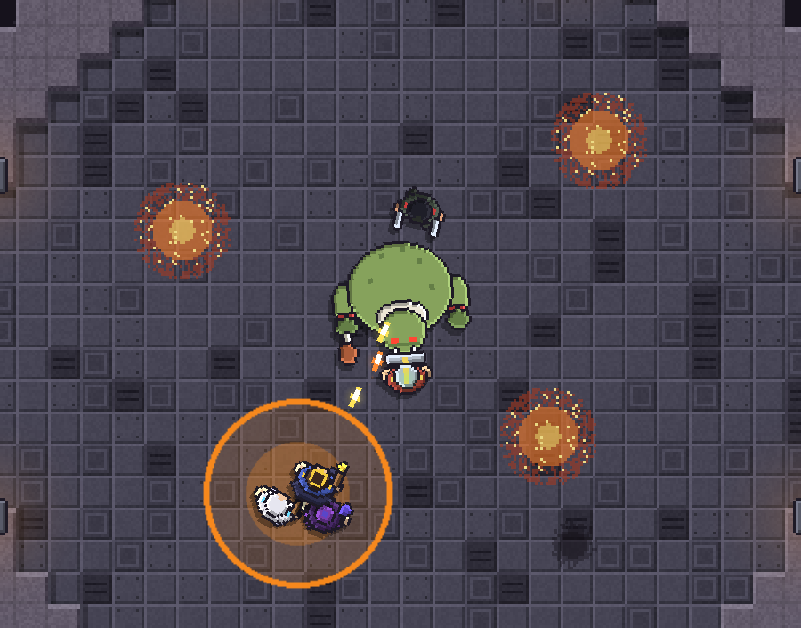
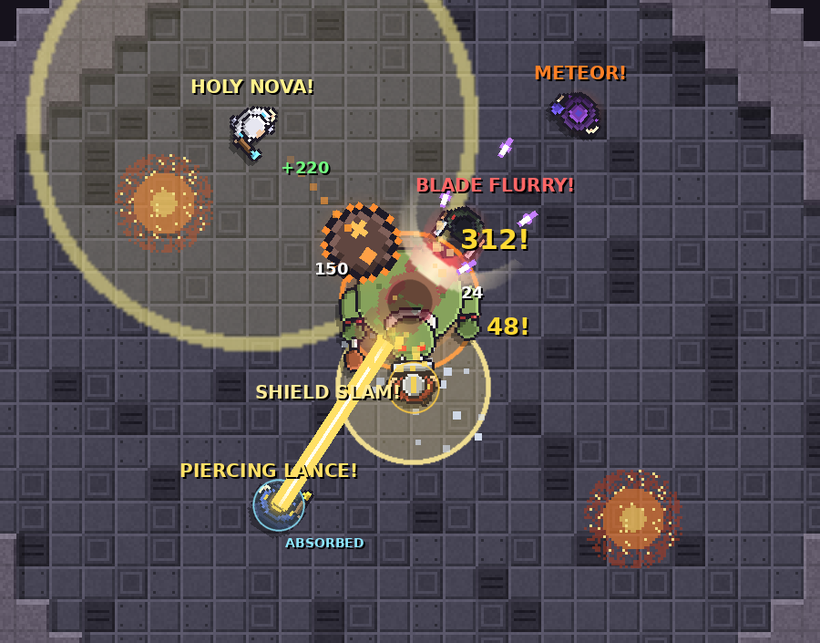

# Ready Check

A top-down pixel-art raid-leader game (visual style inspired by Mindustry). You lead a party through dungeon bosses, and your main weapon
is your voice: **Stack! Spread! Kick that cast! Burn it down!** Your party learns every fight with
you, so each wipe makes the next pull better.



Built in **Unity 6** for PC (gamepad-first, mouse and keyboard fully supported), with a Nintendo Switch port in mind.
The full design is in [`docs/GAME_DESIGN.md`](docs/GAME_DESIGN.md).

---

## Running it on your computer

### 1. Install the tools (one time)
1. Install **[Unity Hub](https://unity.com/download)** and sign in. A free Unity Personal license is fine.
2. In Unity Hub → **Installs** → **Install Editor**, install a **Unity 6 LTS** version (`6000.x`).
   You don't need any extra modules to play in the editor. To make a standalone build, add
   *Windows Build Support (IL2CPP)* or *Mac Build Support*.
3. Install **[Git](https://git-scm.com/downloads)** if you don't have it.

### 2. Get the project
Clone the repository:

```bash
git clone https://github.com/pablogodiaz/rpg-game.git
```

Go into the folder:

```bash
cd rpg-game
```

Until the first iteration is merged into the main branch, switch to the branch it lives on:

```bash
git checkout claude/nice-dirac-8qnmxz
```

### 3. Open it in Unity
1. In Unity Hub → **Projects** → **Add** (or **Open**) → **Add project from disk**, and choose the `rpg-game` folder.
2. The project asks for `6000.0.23f1`. If you installed a different Unity 6 version, Hub shows a
   warning. Click the version and pick the Unity 6 editor you have. Any 6000.x works, and Unity upgrades the project for you.
3. The first open takes a few minutes while Unity imports packages and generates its project files.
4. **If you get the "Enable new Input System backends?" dialog, click _Yes_.** Unity restarts.
   The game uses the new Input System for gamepad and keyboard support.
   - Didn't get the dialog, and the game shows a red *"Input System backend is disabled"* message?
     Go to **Edit → Project Settings → Player → Other Settings → Active Input Handling**, set it to
     **Input System Package (New)**, and let Unity restart.
5. The project creates and opens `Assets/Scenes/Main.unity` on first load. If it isn't open, use the
   menu **Ready Check → Open Main Scene**.

### 4. Play
Press **▶ Play** at the top of the editor. The scene looks empty in edit mode. That's expected,
because the game builds the arena, party and boss from code when you press Play.

Tip: in the **Game** view, set the aspect dropdown to *16:9* or *Full HD* and enable *Play Maximized*
for the best view.

### Making a standalone build (optional)
**File → Build Profiles** (on older 6000.0 versions: **File → Build Settings**) → pick Windows or macOS →
make sure `Scenes/Main` is in the scene list → **Build**. Run the resulting executable.

---

## How to play (first iteration)

You're the **Raid Leader** (the one with the crown and the gold ring under your feet). With your party of four, you fight
**Rotgut the Hungry**, an ogre with poor table manners. He enrages at **3:00**.

| Mechanic | What happens | Your call |
|---|---|---|
| **Belly Flop** | An orange circle appears under someone. Rotgut jumps on it and the damage is split between everyone inside. Fewer than 3 people means deaths. If nobody's inside, the whole raid gets hit. | Run into the circle and call **STACK** |
| **Indigestion** | Everyone gets a purple ring. When it pops, it damages every *other* member inside the ring. | Call **SPREAD**, then go to your **YOU** marker |
| **Second Breakfast** | An interruptible cast (yellow cast bar). If he finishes eating, he heals and gets stronger (*Well Fed*). | Call **INTERRUPT** |
| **Grease Fire** | Fire puddles appear under people. Members walk out on their own, but how fast depends on their **Awareness**. Grenn is a *Fire Enthusiast*... | Move out yourself |
| **Phase 2 (50%)** | Everything happens more often. | Use **BURN** and **Rally** wisely |

### Your raid



| Member | Signature abilities (used on their own, with visible effects) | Interrupt |
|---|---|---|
| **Grenn** (Guardian, tank) | **Taunt**: yellow tether, yanks Rotgut back when he turns on someone · **Shield Slam**: shockwave, big threat, staggers the boss · **Bulwark**: golden shield bubble, -55% damage (fires on DEFENSIVES) | - |
| **Pip** (Cleric, healer) | **Divine Shield**: cyan bubble that absorbs 450 damage on whoever is about to die (DEFENSIVES) · **Holy Nova**: expanding ring that heals everyone nearby | - |
| **Vex** (Duelist, melee) | **Blade Flurry**: shadowsteps through the boss leaving afterimages, then 6 slashes and a finisher (BURN). Highest crit chance | Kick |
| **Moira** (Mage, ranged) | **Meteor**: a meteor drops out of the sky for a big explosion (BURN) · **Arcane Barrage**: 6 missiles that curve into the boss · **Blink**: teleports out of fire and into stacks instead of walking | Counterspell |
| **You** (Raid Leader) | **Piercing Lance**: golden beam · **Rally**: +30% party damage shockwave · **Battle Rez**: brings back the last fallen ally (once per pull) | - |

Every hit shows a damage number (crits are big and yellow), every ability shouts its name over the caster's head,
and buffs are visible on the units: a fiery glow for BURN, a gold glow for Rally and shield bubbles for absorbs.
Your **BURN** call makes Vex and Moira fire their big abilities immediately, and **DEFENSIVES** makes Grenn and
Pip pop their shields. Your calls now come with fireworks.

**Your party learns.** Every member has an **Awareness** stat (how often and how fast they react without
a call), plus a **familiarity** score with Rotgut that goes up after *every* pull, win or wipe. On your
first pull you have to call almost everything. A few wipes later, people start handling mechanics on their own
("I've seen this one!"). Progress is saved between sessions. Press **F9** on the Ready Check screen to reset it.

### Controls

| Action | Gamepad | Mouse & keyboard |
|---|---|---|
| Move | Left stick | WASD / arrow keys |
| Attack (Leader Bolt, auto-targets the boss) | RT (hold) | Left mouse / J (hold) |
| Dodge (brief invulnerability) | A | Space |
| Piercing Lance (golden beam, 7 s cooldown) | X | E |
| Rally (+30% party damage, 90 s cooldown) | Y | R |
| Battle Rez (revive the last fallen ally, once per pull) | B | F |
| **Quick Calls**: Stack / Spread / Interrupt / Burn | D-pad Up / Down / Left / Right | 1 / 2 / 3 / 4 |
| Defensives / As You Were | Raid Wheel | 5 / 6 |
| **Raid Wheel** (slows time to 20%) | Hold LB, aim with right stick, release to call | Hold Q or right mouse, move the mouse toward a call, release to call |
| Ready Check & pull / one more pull | Start or A | Enter or Space |
| Toggle mechanic hints | Select | H |

---

## Project layout

```
Assets/
  Editor/ProjectSetup.cs        creates the Main scene and adds it to the build on first open
  Scripts/
    Core/                       bootstrap, input, camera, slow-mo, arena, procedural pixel art
    Combat/                     units, buffs, projectiles, combat log
    Party/                      member data and roster, shared member logic, AI, leader controls
    Commands/                   raid calls (Stack, Spread, Interrupt, Burn, ...)
    Boss/                       Rotgut, telegraphs, fire puddles
    Encounter/                  pull / wipe / victory flow, saved progress (familiarity)
    UI/                         HUD, call wheel, raid frames, speech bubbles and all the bark lines
docs/GAME_DESIGN.md             game design document
```

A few notes on this first iteration:
- **Everything is generated from code**: top-down pixel sprites (outlined parts, palette swaps), the tile-map arena and the UI.
  That means there are no binary assets yet, so it's easy to review and diff. Real pixel art and prefabs
  replace these pieces over time.
- **The HUD uses IMGUI** as a placeholder. A proper pixel-art UI comes later.
- **Party members share one `PartyMember` component that is driven by either AI or a player.** This
  is what keeps local co-op (a later feature) a small change.
- It uses the built-in render pipeline for now, to keep the first open simple. Moving to URP (the plan for decals and
  Switch scalability) is on the roadmap.

> After the first open, Unity generates a `.meta` file next to every file in `Assets/` and fills in
> `ProjectSettings/`. Commit those. They're part of a Unity project (`Library/`, `Temp/` and friends are ignored).

## Troubleshooting

- **Nothing happens when I press Play / the screen is just dark blue.** Make sure the open scene is
  `Main` (**Ready Check → Open Main Scene**). The game only boots itself in `Main`, `SampleScene` or an
  empty untitled scene.
- **Keyboard or gamepad does nothing.** See step 3.4 above (Active Input Handling).
- **Console shows package errors on first open.** Open **Window → Package Manager**, let it resolve, or
  update *Input System* to the version Unity recommends for your editor.
- **Gamepad not detected.** Xbox, PlayStation and Switch Pro controllers work over USB or Bluetooth.
  Connect the controller before pressing Play.
