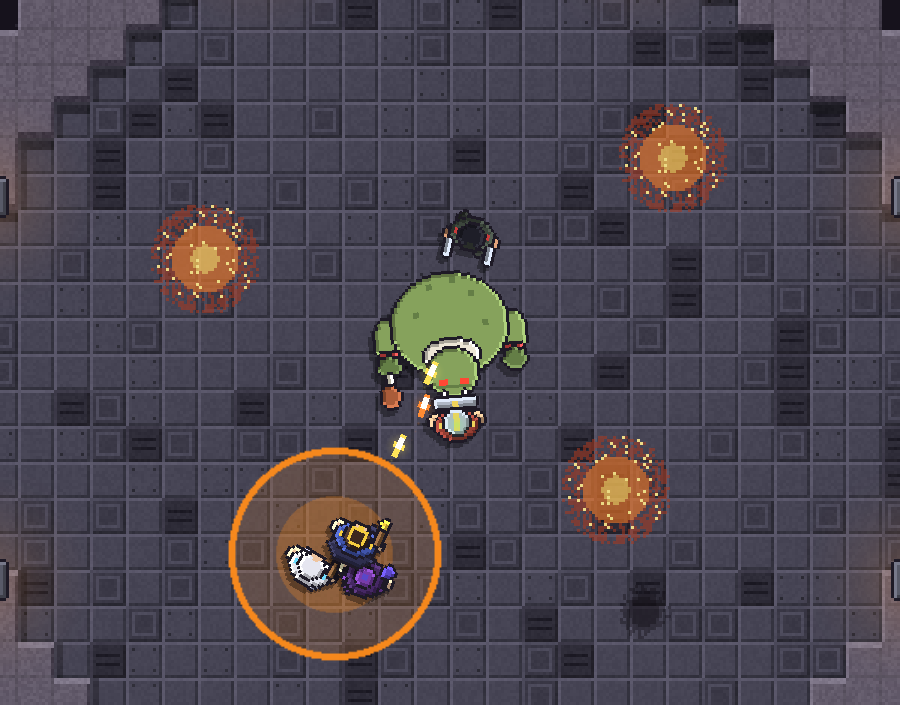

# Game Design Doc (draft v0.2)

> Working title: **Ready Check**. Other options: *Pull Timer*, *Wipe & Learn*, *The Raid Leader*.
> This is a living document. Items marked **[OPEN]** are decisions still to make.

### Decision log
| Date | Decision |
|---|---|
| v0.2 | Real-time with **slow-mo while commanding** (no full pause in the default mode) |
| v0.2 | Tone: **affectionate MMO-raid parody** |
| v0.2 | ~~Visual style: 2.5D pixel art (pixel sprites in a 3D world)~~ (replaced in v0.3) |
| v0.2 | **Local co-op** as a later feature. The architecture has to allow it from day 1 |
| v0.2 | Engine: **Unity 6 LTS** (URP), chosen for official Switch / Switch 2 support |
| v0.3 | Visual style: **top-down pixel art inspired by Mindustry**: straight-down camera, outlined units seen from above |
| v0.3 | Balance: party roughly 1.6–1.8x stronger (damage, health, heals). Rotgut slightly less punishing |

---

## 1. Pitch

You lead a raid party through dungeons and boss fights. You fight in the battle yourself, but your
real weapon is your voice. You call out mechanics, assign targets, place markers and decide when to
burn cooldowns. Your party starts as three scrappy recruits and grows into a full raid of
specialists. Each one has a role, a personality, and strong opinions about who deserved that loot drop.

**The fantasy:** being the person on voice chat who says *"Spread for bombs... tanks swap NOW... burn
it, burn it!"* and watching the boss go down because of the calls you made. And then saying it all
again because someone stood in the fire.

**Pillars**
1. **Command is the core verb.** Every boss is a puzzle solved through calls, not just button mashing.
2. **Roles matter.** Tank, healer and DPS play differently and need different orders.
3. **Wiping is progress.** Failed attempts teach your party. Each try goes better.
4. **Controller-first.** Every command has to be fast to give on a gamepad. Mouse and keyboard is a bonus.
5. **Funny people, fair fights.** The jokes live in the characters, the guild drama and the writing.
   Boss mechanics are never a joke at the player's expense: they're always readable and fair.

---

## 2. Tone & writing

**Affectionate parody of MMO raiding culture.** It's made by people who love raiding and pokes fun at the
rituals: loot drama, "one more pull", the guy who's always AFK on the pull, the rival guild posting
kill screenshots. It is **not** mean-spirited, and it doesn't depend on knowing real games' memes.
Someone who has never played an MMO should still find the characters funny.

**Where the humor goes**
- **Party barks** (short voice lines / speech bubbles), the main source of personality:
  - On a call: "On it!" · "Kicking!" · "Wait, which left?" · "Can't, cooldown!"
  - On a wipe: "Lag." · "That was the healer." · "That was NOT the healer." · "One more pull?"
  - On pulling: "Did someone pull? Who pulled?!"
- **Guild chat** in the hub: a scrolling log of members chatting, complaining and arguing about loot.
- **In-world MMO-isms:** *DKP* = **Dungeon Kudos Points**, the guild's official currency. Bosses have
  "enrage timers" because they genuinely get annoyed. Loot item descriptions read like patch notes.
- **Rival guilds** with names like *<Totally Casual>*, *<Pull Timer Enjoyers>*, *<Mom Said One More Raid>*.
- **Boss personalities:** bosses comment on your wipes ("Back again? I've rearranged the furniture.").

**Where it doesn't go:** telegraphs, UI clarity and the difficulty curve. A death should always read as
*"I should have called Spread"*, never *"the game cheated"*.

---

## 3. Core gameplay

### 3.1 Perspective & time
- **Top-down orthographic camera** looking straight down (see section 6). Ground telegraphs (circles, cones, lines)
  stay easy to read, it works well with a controller, and it's cheap enough for Switch.
- **Real-time with slow-mo while commanding.** Holding a command wheel slows the game to ~20%. When you let go, it
  goes back to full speed. There's no full pause in the default mode. That keeps the pressure on and makes good
  calls feel skillful.
  - Accessibility options: adjustable slow-mo strength (down to ~5%) and an "Assist" mode with a full pause.

### 3.2 The Leader (you)
You control one character directly. It has two kits:

| Kit | What it is |
|---|---|
| **Role kit** | You pick a role (Tank / Healer / DPS / Support) and play it like any member. |
| **Leader kit** | Shared across all roles: Rally (raid-wide damage buff, long cooldown), Battle Rez (limited charges), Ready Check (pre-pull buff), Markers. |

Your role changes how you play. As a **healer** you see everyone's health bars and command from the back.
As a **tank** you're in the boss's face and have to call things while you're under pressure. That gives
the game a lot of replay value.

### 3.3 Calls (the command system)
Calls are the heart of the game. There are three layers, from fastest to most detailed:

**1. Quick Calls (D-pad, one press)**: four customizable slots, e.g.
- Up: **Stack** (gather on leader/marker)
- Down: **Spread**
- Left: **Interrupt!** (nearest interrupter kicks current cast)
- Right: **Burn / Cooldowns** (all DPS pop offensive cooldowns)

**2. Raid Wheel (hold LB, slow-mo)**: global calls on a radial menu:
Stack · Spread · Fall Back · Move to Marker · Focus Target · Hold DPS · Defensives · Dispel

**3. Role Wheel (hold RB → pick group → pick order, slow-mo)**: targeted orders:
- *Tanks:* Taunt / Swap / Pick up adds / Face boss away
- *Healers:* Focus tank / Raid heal / Save mana / Use big cooldown
- *DPS:* Switch to adds / Stay on boss / Soak / Kite
- *Individual:* Later on, you can pick a specific member from the wheel for a precise call ("Mira, take the left soak").

**Markers**: point at enemies or the ground and drop raid symbols (Skull, X, Square, Star...).
Markers are the bridge between calls and positioning: "Tanks to Square", "Kill order: Skull then X".

> Design rule: any call must take **≤ 2 inputs and ≤ 1 second** on a controller. If it doesn't, it's too complex
> or it belongs in pre-fight planning.

### 3.4 Party AI: how members respond
Each member runs on a priority stack:

```
Human player input (co-op)  >  Leader Call  >  Pre-fight Tactics  >  Role default behavior
```

- **Role default**: tanks hold aggro, healers heal the lowest HP, DPS hits the current target.
- **Pre-fight Tactics** (set in the planning screen, simple rules in the style of FFXII gambits):
  e.g. "Healer: keep the main tank above 70% first", "DPS: always switch to Totems".
- **Leader Call**: overrides both for a few seconds, or until done.

**Awareness stat (key mechanic):** Each member has an *Awareness* value. With low awareness they react late or not
at all unless you make the call. With high awareness they handle known mechanics on their own.
This is how the game's difficulty grows along with your raid:
- Early: you call *everything*.
- Late: veterans handle the basics and you focus on the hard, big-picture calls.

**Boss Familiarity:** Each member has a hidden familiarity score per boss. It goes up with every attempt,
win or wipe. After five wipes on a boss your team visibly dodges its slam better. This makes
progression raiding work in a single-player game: failure isn't wasted time.

### 3.5 Combat roles

| Role | Job | Signature mechanic | Example subclasses |
|---|---|---|---|
| **Tank** | Hold aggro, take hits, position the boss | Threat meter, active mitigation, tank swaps | Guardian (shield), Juggernaut (self-heal), Evasion tank |
| **Healer** | Keep the raid alive, manage mana | Mana economy, triage, big cooldowns | Cleric (direct), Druid (heal over time), Bard (shields) |
| **Melee DPS** | High damage, must manage positioning | Behind-the-boss bonus, cleave risk | Duelist, Berserker |
| **Ranged DPS** | Safe damage, handles ranged mechanics | Cast times (have to stop casting to move) | Mage, Hunter |
| **Support** | Buffs, debuffs, interrupts, crowd control | Limited-charge utilities | Chronomancer, Warchanter |

#### Signature abilities (v0.4)
Members aren't just stat sticks. Each has a small kit of **loud, readable abilities** that the AI uses on its own
when the moment is right. The player always sees *who did what*: a callout over the caster's head, a distinct
effect shape and color per ability, damage numbers with big crits, and buff auras on the units.

| Member | Signature abilities (used on their own, with visible effects) | Interrupt |
|---|---|---|
| **Grenn** (Guardian, tank) | **Taunt**: yellow tether, yanks Rotgut back when he turns on someone · **Shield Slam**: shockwave, big threat, staggers the boss · **Bulwark**: golden shield bubble, -55% damage (fires on DEFENSIVES) | - |
| **Pip** (Cleric, healer) | **Divine Shield**: cyan bubble that absorbs 450 damage on whoever is about to die (DEFENSIVES) · **Holy Nova**: expanding ring that heals everyone nearby | - |
| **Vex** (Duelist, melee) | **Blade Flurry**: shadowsteps through the boss leaving afterimages, then 6 slashes and a finisher (BURN). Highest crit chance | Kick |
| **Moira** (Mage, ranged) | **Meteor**: a meteor drops out of the sky for a big explosion (BURN) · **Arcane Barrage**: 6 missiles that curve into the boss · **Blink**: teleports out of fire and into stacks instead of walking | Counterspell |
| **You** (Raid Leader) | **Piercing Lance**: golden beam · **Rally**: +30% party damage shockwave · **Battle Rez**: brings back the last fallen ally (once per pull) | - |

Every hit shows a damage number (crits are big and yellow), every ability shouts its name over the caster's head,
and buffs are visible on the units: a fiery glow for BURN, a gold glow for Rally and shield bubbles for absorbs.
Your **BURN** call makes Vex and Moira fire their big abilities immediately, and **DEFENSIVES** makes Grenn and
Pip pop their shields. Your calls now come with fireworks.

Design rules for abilities:
- **One look per ability.** Shape and color identify it at a glance (Grenn = gold/white, Pip = cyan/holy yellow,
  Vex = red, Moira = orange/purple, you = gold).
- **Calls trigger kits.** BURN fires burst abilities and DEFENSIVES fires defensive ones, so commanding has visible payoff.
- **Big hits feel heavy:** a short hit-stop and screen shake on Meteor, Shield Slam, Blade Flurry's finisher and Belly Flop.
- **AI uses abilities with simple, legible rules** (taunt when the boss turns away, shield whoever is below 35%,
  nova when 3+ are hurt), so players can learn what their raid will do.

Shared role duties are spread across subclasses on purpose. Not every class can interrupt, dispel or battle rez,
so **raid composition is a real choice**.

---

## 4. Progression

### 4.1 Party size curve
Party size is also a **tutorial pacing tool**. Each step up adds a new command layer.

| Stage | Size | What it teaches |
|---|---|---|
| Act 1 | 3 (you + tank + healer) | Basic calls, individual orders |
| Act 2 | 5 (dungeon group) | Full holy trinity, interrupts, markers |
| Act 3 | 10 (raid) | Role groups, split mechanics, tank swaps |
| Act 4+ | 10 active + bench of ~20 | Comp building per boss, two squads (A/B team calls), **co-op unlocks** |

Recommend capping **active party at 10** for readability and Switch performance. Grow the *roster*
(bench) instead of the active party. **[OPEN]**

### 4.2 Loops
- **Moment (seconds):** read the telegraph → make the call → party reacts.
- **Encounter (minutes):** trash pulls → boss → loot.
- **Session (an hour):** clear or attempt a dungeon, go back to the Guild Hall.
- **Meta (the whole game):** grow the roster, gear up, unlock harder dungeons and Heroic/Mythic versions.

### 4.3 The Guild Hall (hub)
- **Recruitment:** an applications board with joke application letters ("I have 40 years of experience
  tanking. References: my mom."), the tavern, members rescued during dungeons, trial runs.
- **Roster & Bench:** choose who raids. Benched members still gain a little XP. Benched members also post
  passive-aggressive messages in guild chat.
- **Planning Table:** set the comp, Tactics presets and opening marker positions per boss. Watch the death
  log from past wipes ("Grenn died to: Standing In Fire (x14)").
- **Loot distribution:** *you* decide who gets each drop. Options: Need/Greed roll, Dungeon Kudos Points,
  or Loot Council (you choose). Choices affect **Morale**. Give the healer's trinket to the mage and expect
  a 3-paragraph guild chat post about it.
- **Training grounds:** spend gold/time to raise Awareness or teach a member a specific mechanic. Training
  dummies have their own barks.
- **Guild drama events:** small random events between raids. Two members fighting over a role, someone
  threatening to quit for <Totally Casual>, a member asking for "loot priority because it's my birthday".
  You make a choice, and it affects morale.

### 4.4 Member personalities (traits)
Funny, with a mechanical effect:
- *Fire Enthusiast*: slow to leave ground effects. *Clutch*: stronger below 20% boss HP.
- *Tilt-Prone*: loses morale after each wipe. *Calm Voice*: raises nearby members' Awareness.
- *Loot Goblin*: big morale swing from loot decisions. *Veteran*: starts with high Awareness, asks for more pay.
- *Eager Puller*: small chance to pull the boss before Ready Check finishes.
- *Always AFK*: needs a nudge (Ready Check) at the start of every fight, but has huge DPS once awake.
- *Backseat Leader*: sometimes makes their own (usually wrong) calls in chat. Rarely they're right, and they won't let you forget it.

### 4.5 Rival guilds
Other guilds race you through the same content. A news board posts things like "<Pull Timer Enjoyers>
defeat Gravemaw (World First!) [screenshot of 40 people jumping on a corpse]". It gives the campaign a sense
of time and competition, and story too: recruits poached by rivals, and rival guild leaders as recurring
characters who are a bit smug.

---

## 5. Boss design

Each boss is built around **one primary call** it teaches, then remixes old ones.

| # | Boss (placeholder) | Teaches | Key mechanic | Parody flavor |
|---|---|---|---|---|
| 1 | Rotgut the Hungry (**built**) | Stack, Spread, Interrupt | Belly Flop soak, Indigestion spread, Second Breakfast kick, grease fires | Spends the fight complaining the dungeon's catering is late |
| 2 | Krakenna the Clingy (**built**) | **Focus / switch targets** | Eight breakable arms: slams, hugs (free the victim), Clingy Frenzy → Ink Tsunami scaled by arms left | Just wants a hug. Every arm has a name, and she grieves each one |
| 3 | Sister Vell | **Interrupt** | Casts a raid-wipe spell every 20s, must be kicked | Will not stop talking. Every interrupt cuts off a sentence |
| 4 | The Twin Hounds | **Markers / Kill order** | Two bosses, kill within 10s of each other | Sibling rivalry: they insult each other between phases |
| 5 | Gravemaw | **Tank Swap** | Stacking debuff on the active tank | Has survived so many balance patches it's self-aware about it |
| 6 | The Conductor | **Spread / Stack** | Alternates between chain lightning (spread) and a meteor (stack) | Mechanics are timed to the boss music, which he is conducting |
| 7 | Hive Queen | **Switch to adds** | Add waves heal the boss if they reach it | The adds are her unpaid interns |
| 8 | The Clockwork Council | Everything | 3 bosses, rotating abilities, burn phase with an enrage timer | A literal committee. They pause the fight to vote on mechanics |

### Krakenna the Clingy (boss 2) in detail
- **Arms as targets:** each of the eight arms is a separate unit (800 HP) drawn as a swaying chain of tentacle
  segments. Breaking one removes its attacks, deals 4% of Krakenna's max HP and announces its name
  ("NOT GARY!"). All eight broken → Exposed (+50% damage taken).
- **Tentacle Slam:** the arm pointing closest to a random member rears up and telegraphs a 9.5 m line. AI
  members dodge with a reaction time based on Awareness and Familiarity, plus some randomness for low Awareness.
- **Clingy Hug:** grabs a non-tank, lifts them and reels them in. 450 damage to that arm frees them; after 8 s they're
  squeezed (600) and thrown. Teaches the new **FOCUS** call; aware damage dealers go to the rescue on their own.
- **Ink Cloud:** interruptible. Otherwise every member gets an ink puddle (slow + small burn).
- **Clingy Frenzy** at 70% / 40%: a 10 s channel of constant slams, then **Ink Tsunami** = 110 x arms still attached.
  The fight's core decision is how many arms to break versus how fast to burn the body.

**Boss rules**
- Every dangerous attack has a **clear telegraph** (visual and audio) with enough lead time to make a call.
- Phases change at HP thresholds. Wipes show "Best attempt: 34%" to show progress.
- Difficulty modes add mechanics instead of just more HP (Normal → Heroic → Mythic).

---

## 6. Art direction: top-down pixel art (Mindustry-inspired)

The reference is **Mindustry's readability**: a straight-down view, chunky outlined pixel sprites and clean
glowing effects. All art is our own. We borrow the *approach*, never assets or exact designs.



*A mock frame put together from the sprites the game generates (lamp glows not to scale). It shows the
party stacking in a Belly Flop circle while the tank holds Rotgut.*

- **Camera:** orthographic, straight down. The zoom is always a whole number of screen pixels per art pixel,
  and the camera snaps to the screen-pixel grid, so pixels stay crisp at any resolution.
- **One pixel density:** every sprite is drawn at 12 px per world unit (one floor tile = 12 px), so pixels
  line up across characters, floor and boss.
- **Units seen from above:** the **body rotates to face its target** and **feet step underneath** in the
  walking direction (instead of drawing 4–8 facing directions, which also saves a lot of art). Each part
  (head, hands, gear, body) has its own **dark outline** and simple top-left bevel lighting.
- **Silhouette = role:** the tank carries a tower shield in front, the healer a staff with a gem, the duelist
  twin daggers, the mage a wide hat and an orb. The leader has a crown, a scepter and a cape.
  **Team color** (warm yellow) marks the party's shoulder pads. Enemies get red accents (Rotgut's cuffs).
- **Character variety on a budget:** one body per class plus **palette swaps**. Goofy hats are still part of the parody.
- **Shadows:** a dark, offset copy of the sprite (down-left). During a leap it grows and moves further out,
  which sells height without 3D.
- **Environment:** tile maps with metal floor plates, panels and vents, ringed by beveled rock walls that cast
  shadows. Lamps set into the walls throw soft pools of light.
- **Effects:** smooth (not pixelated) shapes, just like vector effects. Telegraph circles that fill up, shockwave rings on
  impacts, bright bullets with a white-hot core and a short trail, a scorch mark where someone went down.
  Telegraph colors are high-contrast and must stay readable over any floor.
- **Upgrade path:** move to **URP's 2D Renderer** for real 2D lights (lamps, bullet glow, spell flashes) and
  hand-made sprite sheets that replace the generated sprites one by one.

---

## 7. Controls

### Gamepad (primary)
| Input | Action |
|---|---|
| Left stick | Move leader |
| Right stick | Aim / soft-target |
| A / B / X / Y | Leader role abilities |
| RT | Basic attack / primary |
| LT (hold) | Target lock / cycle targets |
| **LB (hold)** | **Raid Wheel** (slow-mo) |
| **RB (hold)** | **Role Wheel** (slow-mo) |
| D-pad | Quick Calls (4 slots) |
| R3 | Drop marker at aim point |
| Start | Pause menu (out of combat) / options |
| Select | Raid frames / damage meter toggle |

### Mouse & keyboard
WASD move, mouse aim, 1-5 abilities, Q/E hold for wheels, F1-F4 quick calls, Ctrl+click to place markers.

Every action must be rebindable. Use one input-action layer from day 1 so both schemes stay equal.
Note: Switch Joy-Con have no analog triggers. Never rely on analog trigger pressure.

---

## 8. Co-op (later stage)

**Local co-op, 2–4 players, unlocked in the later game (Act 4+). Online co-op is out of scope.**

### How it works
- Player 1 stays the **Raid Leader** and is the only one with raid-wide calls and markers.
- Players 2–4 **take control of an existing party member** (drop-in / drop-out). When they leave, the AI
  takes the member back without a hitch.
- Co-op players get a **Ping** button (e.g. "Help me!" / "Adds here!") but not raid calls. One leader, like
  a real raid.
- Leader calls show up for co-op players as on-screen prompts. Human players can ignore them... and the
  game *will* notice ("Player 2 has ignored 4 calls. Morale: amused.").
- **Shared camera**, no split-screen. The camera zooms out to fit everyone, with a leash so players can't wander too far apart.
- Slow-mo in co-op: when the leader opens a wheel, time slows for everyone. **[OPEN]**: test whether this
  annoys other players. The fallback is a smaller slow-mo effect in co-op.

### What this means for the architecture now (important)
Co-op comes late, but adding it later is cheap **only if** we plan for it today:
1. **Every party member uses the same "controller" interface.** `AIController` and `PlayerController`
   both drive the same `PartyMember`. The leader is just a party member with a player controller and the Leader kit.
2. **Input goes through Unity's Input System with per-player devices** (`PlayerInput` / `PlayerInputManager`)
   from the start, never via global `Input.GetKey`.
3. **UI must be able to show multiple players' cursors/prompts.** Keep player-specific UI in its own layer.
4. **No online netcode.** Local co-op only, which avoids the big architecture cost of online play.

---

## 9. UI / UX
- **Raid frames** (health bars for the party) in a corner, by role, colored by health, with debuff icons.
- **Boss cast bar** big and central, with an interruptible indicator (a shield icon when it can be interrupted).
- **Call feedback:** when you call, members visibly answer with a bark ("On it!", "Kicking!", "Can't, on
  cooldown!"). This is the main way the game shows a call was understood, and it's where most of the personality shows.
- **Post-fight report:** damage/healing meters, deaths and their causes, which calls were made and when.
  Plus a joke "award" each fight ("Most Fire Stood In: Grenn").
- **Pixel-art UI** to match the world, with crisp scaling at 720p (Switch handheld) through 4K.

---

## 10. Technical direction

### Engine: Unity 6 LTS
**Why Unity:** Nintendo Switch (and Switch 2) is an **officially supported Unity build target**. You
develop on PC as normal, and once you're an approved Nintendo developer you install the Switch build module
and build for it. Starting in Unity means no engine migration and no third-party porting studio later.

**What "portable" still requires** (worth knowing up front):
- Registering on the **Nintendo Developer Portal** and getting approved, then a dev kit.
  You can (and should) build the whole game on PC first. Apply when there's a polished demo.
- Passing Nintendo's certification process (lotcheck).
- **Performance work.** The original Switch is roughly mobile-class hardware. Switch 2 has more headroom.
- Switch-specific SDK code (accounts, saves, Joy-Con) stays inside a small platform layer.

**Licensing:** Unity Personal is free below a revenue threshold. Check current terms when you get closer to release.

### Stack
| Area | Choice |
|---|---|
| Render pipeline | **URP with the 2D Renderer** (2D lights for glows). Scales from Switch to PC |
| Input | **Input System** package (action maps, rebinding, per-player devices for co-op) |
| Camera | **Cinemachine** (follow, group framing for co-op) |
| Data | **ScriptableObjects** for classes, abilities, bosses, traits, loot, barks |
| Sprites | Flat top-down sprites with rotation, 2D Sprite/Animation tools, point filtering, pixel-perfect camera |
| Language | C# |
| Version control | Git (+ Git LFS for art/audio once binaries get large) |

### Architecture notes
- **Data-driven content:** abilities, bosses, traits and barks are ScriptableObject assets, so new content
  means creating new assets, not writing code.
- **Party member = shared component + swappable controller** (AI / local player). See the co-op section.
- **AI:** Utility AI per member (score possible actions), with a **Command layer** on top that injects
  high-priority goals. Awareness = reaction delay + chance to self-respond to known mechanics.
- **Boss scripting:** timeline + phase state machine. Each mechanic raises a `MechanicIncoming` event that
  AI, barks, the familiarity system and telegraph visuals all subscribe to.
- **Time scaling:** slow-mo via `Time.timeScale`. UI and wheel animations use unscaled time.
- **Platform layer:** saves, achievements and platform-specific input glyphs behind interfaces
  (`ISaveService`, etc.) so the Switch version only swaps implementations.
- **Performance budget (set early, test often):** target 60 fps on PC / Switch 2, 30+ fps on Switch 1.
  Cap ~10 party members + ~20 enemies on screen. Keep particle counts and post-processing low.

---

## 11. Scope & milestones

### Iteration 1: done (playable)
A first playable version of the core loop, built entirely from code (no imported assets yet):
- One boss, **Rotgut the Hungry**, with four mechanics that each teach a call: Belly Flop (Stack),
  Indigestion (Spread), Second Breakfast (Interrupt), Grease Fire (move out of bad). Phase 2 at 50%, enrage at 3:00.
- A party of 5: Leader (you), Grenn (Guardian/tank), Pip (Cleric/healer), Vex (Duelist/melee, interrupter),
  Moira (Mage/ranged, interrupter, Backseat Leader).
- Quick Calls (D-pad / 1-6) and the Raid Wheel with **20% slow-mo**. Leader kit: Leader Bolt, Dodge, Rally.
- Party AI with the Awareness stat plus **Boss Familiarity saved between sessions**.
- Traits with effects: Fire Enthusiast, Clutch, Backseat Leader. Tilt-Prone is flavor only for now.
- Parody barks, a Ready Check → pull → wipe/victory loop, a post-fight report with joke awards, and joke loot.
- Procedural top-down pixel art (outlined parts, rotating bodies with stepping feet, tile-map arena, shadows,
  bullets with trails). Iteration 1 shipped with a 2.5D billboard look, and this replaced it in v0.3.

Known shortcuts to revisit: IMGUI HUD (placeholder), built-in render pipeline instead of URP, plain-data
roster instead of ScriptableObjects, PlayerPrefs saves.

### Iteration 2: signature abilities (done)
Added class kits (see section 3.5), an effects system (pooled particles, floating numbers and callouts, beams,
slashes, afterimages, meteors, hit-stop), crits, absorb shields, Battle Rez, buff auras, and the BURN/DEFENSIVES
calls firing abilities. Raid frames show each member's ability cooldowns.

### Iteration 3: second boss (done)
Bosses now share a `BossController` base (casting, interrupts, threat, enrage, barks) and live in a `BossRoster`,
selectable on the Ready Check screen. Added **Krakenna the Clingy** with breakable arms, the **FOCUS** call and skull
marker, line-shaped danger telegraphs the AI dodges, ink puddles that slow, being grabbed (leader can wriggle free),
a sunken-grotto arena theme, and per-boss saves, loot and lines.

### Next up (suggested)
1. Playtest and tune Rotgut (damage numbers, timings, Awareness/Familiarity curve).
2. Move to URP with the 2D Renderer and 2D lights (section 6).
3. Data: move classes, abilities, traits and bosses into ScriptableObjects.
4. Bosses 2–3 (Sister Vell, Gravemaw) and markers (Skull/X), which completes the vertical slice.

**Milestone 0: Tech prototype (1–2 weeks)**
- Unity 6 URP project, Input System set up for gamepad + KBM
- Top-down pixel sprite moving on a tile map, pixel-perfect orthographic camera
- A ground telegraph and a dummy enemy

**Milestone 1: Vertical slice** (prove the core is fun):
- 1 dungeon, 3 trash packs, **3 bosses** (Rotgut, Sister Vell, Gravemaw)
- Party of 5: Leader + Tank + Healer + 2 DPS (fixed members)
- Quick Calls + Raid Wheel (6 calls) with slow-mo + Skull/X markers
- Awareness + Boss Familiarity
- Barks system with a first pass of parody writing
- Simple post-fight report

**Question the slice must answer:** *Is making calls fun, and does a wipe → learn → kill loop feel good?*

**Later:** Guild Hall and loot → recruitment, traits and drama events → 10-person raid and Role Wheel →
campaign content → **local co-op** → Switch performance pass and certification.

---

## 12. Open questions
1. **Max party size:** 10? 20?
2. **Leader:** always a fighter, or allow a pure "commander" camera mode?
3. **Permadeath/injuries** for members, or soft consequences only? (Parody suggests soft ones: "Grenn is
   sulking and won't raid this week".)
4. **Story frame:** why are you raiding? Saving the realm, or just trying to get your guild to #1 on the
   rankings?
5. **Co-op slow-mo** behavior (section 8). Decide after playtesting.
